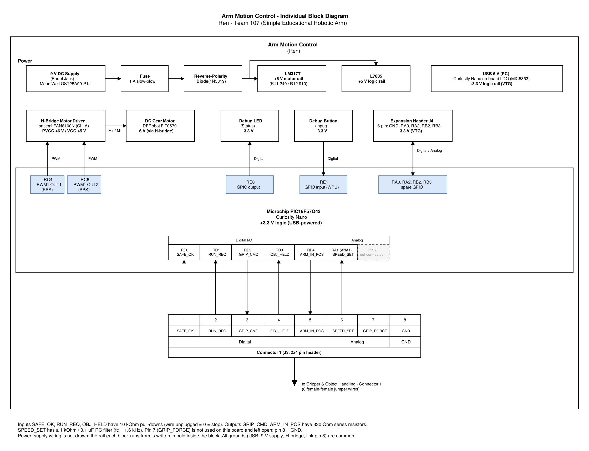

## Overview

This block diagram shows the blocks of the Arm Motion Control board, how power and signals move between them, and how the board connects to the rest of the team.

* **Microcontroller:** the board runs on a PIC18F57Q43 Curiosity Nano. The Nano is powered from its own USB port and uses 3.3 V logic with a 0–3.3 V analog range.
* **Power:** a 9 V DC wall adapter plugs into a barrel jack.
    * The input goes through a 1 A slow-blow fuse and a 1N5819 reverse-polarity diode.
    * An LM317T, set by R11 = 240 Ω and R12 = 910 Ω, makes the 6.0 V motor rail.
    * An L7805 makes the 5 V logic rail.
    * Motor current never passes through the microcontroller board.
* **Actuator:** an onsemi FAN8100N H-bridge drives a 6 V Pololu #2370 DC gearmotor. The motor has two wires, M+ and M−. RB0 and RB1 provide the two PWM inputs through PPS.
* **Debug:**
    * A status LED on RE0.
    * A push button on RE1, using the weak pull-up.
    * Expansion header J4, which brings out 3.3 V, GND and the spare pins RA0, RA2, RB2 and RB3.
* **Team connection:** the board connects to the Gripper & Object Handling board through the 8-pin ribbon cable.
    * It receives SAFE_OK, RUN_REQ, OBJ_HELD and the analog SPEED_SET.
    * It sends GRIP_CMD and ARM_IN_POS.
    * Pin 7 (GRIP_FORCE) is not used on this board and is left open. Pin 8 is GND.
* **Ground:** all grounds are tied together. This includes USB, the 9 V supply, the H-bridge and ribbon pin 8.

## Block Diagram

**Figure 1:** Arm Motion Control individual block diagram.

## Resources

The block diagram source files (the editable draw.io file and the exported PNG) are available as a [*Zip download*](Arm_Motion_Control_Individual_Block_Diagram_source.zip). The draw.io file can also be opened directly: [*Arm_Motion_Control_Individual_Block_Diagram.drawio*](Arm_Motion_Control_Individual_Block_Diagram.drawio).
