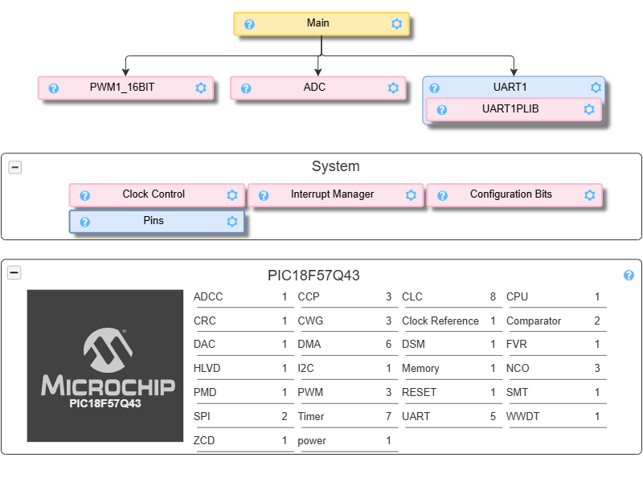
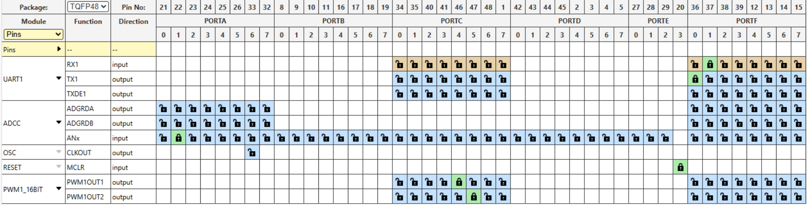
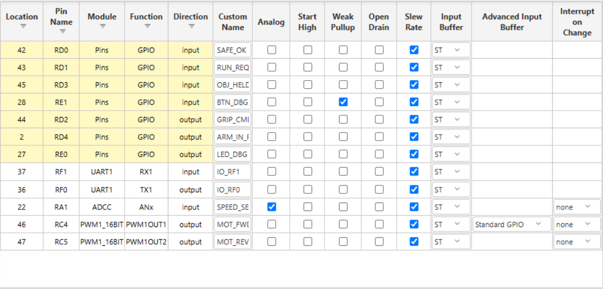
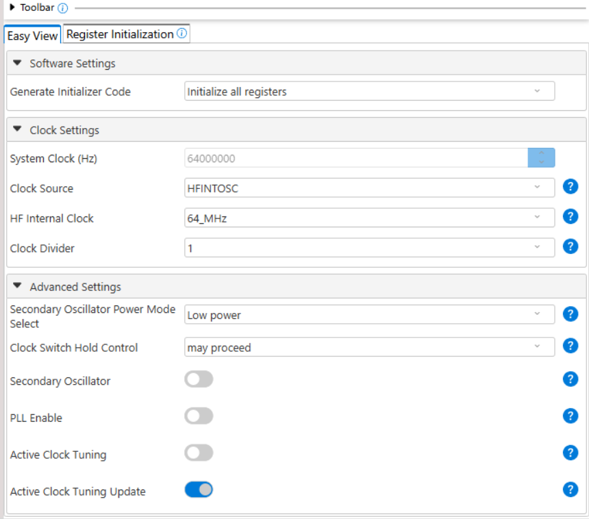
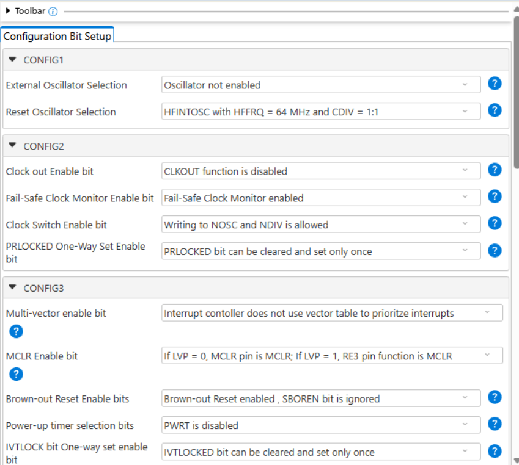
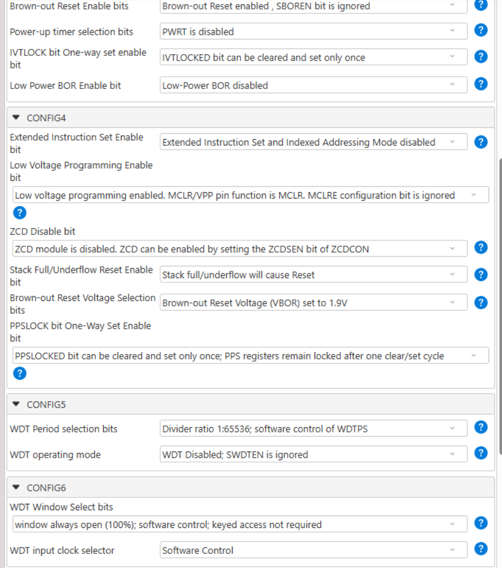
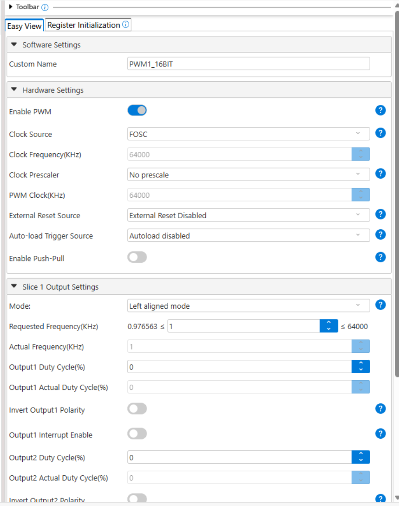
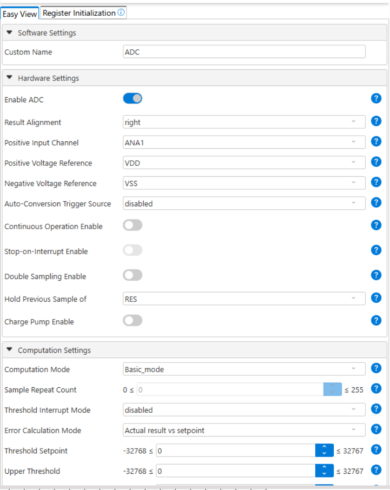
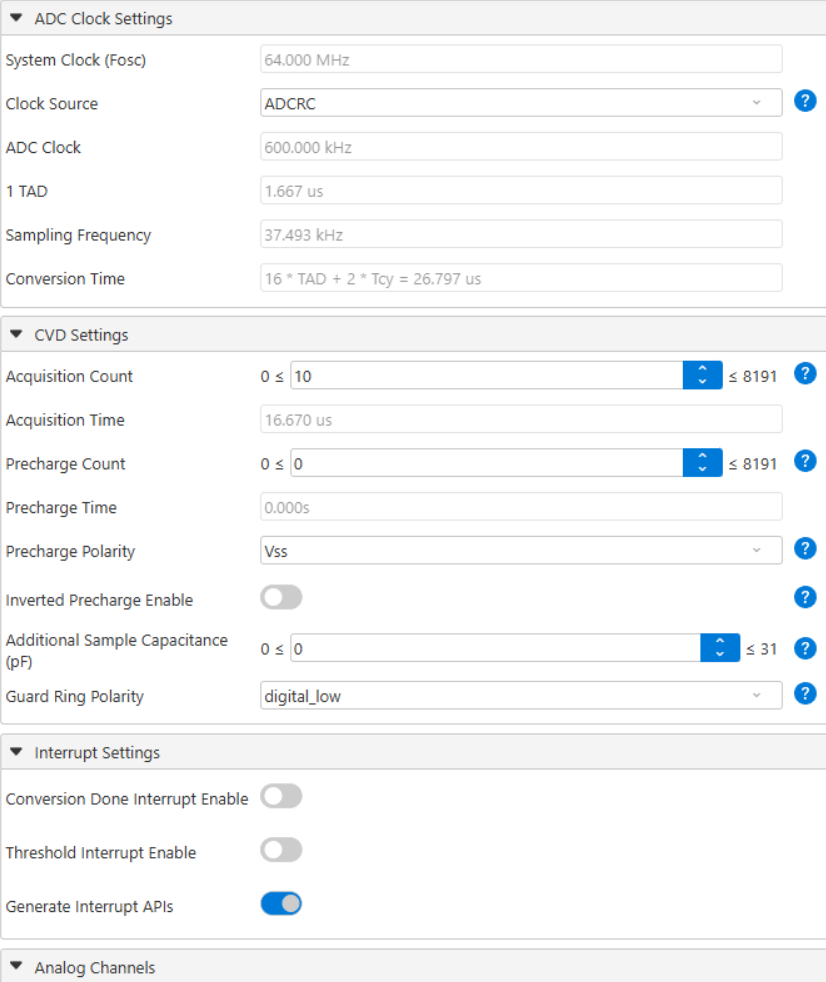
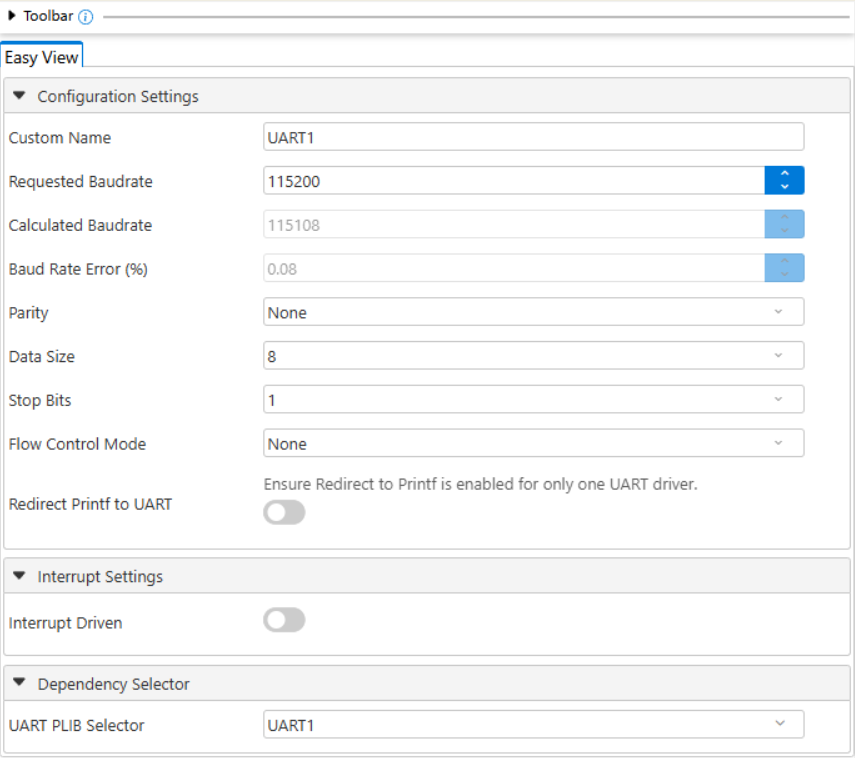

## Overview

This page records how each major part of the **Arm Motion Control** board was chosen. For every function, at least three options were compared, the decision is stated, and the reason is tied to the team's product requirements (PR numbers from the [team report](https://egr304-2026-f-107.github.io/04-Product-Requirements/)). Several choices changed after the first submission; each section says what changed and why.

The same criteria were used for every part:

| Criterion | Why it matters | Related requirements |
|---|---|---|
| Current and voltage ratings above the worst case in this circuit, with margin | Parts must stay inside their limits, including at motor stall | PR-14, Regulation 6.7 |
| Fits the class rules: through-hole (nothing smaller than 0805), not obsolete when ordered, full datasheet, no breakout module without approval | The board must be hand-soldered, prototyped on a breadboard and reviewed | PR-10, PR-14 |
| Uses parts already in hand or stocked in Peralta 109 where possible | Keeps the subsystem inside the team budget | PR-17 |
| Simple interface to the PIC18F57Q43 (few pins, no extra drivers) | Easier firmware and easier for students to follow | PR-07, PR-15, PR-16 |
| Leaves room to add parts later (sockets, spare pins, header) | The arm is meant to be modified and expanded | PR-10, PR-11 |
| Fails safe (protection features, known state when unplugged) | Motion must stop predictably | PR-12, Regulation 6.3 / 6.7 |

## H-Bridge Motor Driver

1. Pololu DRV8874 single brushed DC motor driver carrier

    

    * $11.94/each
    * [link to product](https://www.pololu.com/product/4035)

    | Pros                                      | Cons                                                             |
    | ----------------------------------------- | ---------------------------------------------------------------- |
    | PH/EN mode controls speed and direction with one PWM pin plus one GPIO, which matches our pin map. | Most expensive of the three drivers. |
    | Integrated current sensing and regulation (IPROPI, VREF) limits motor current without an external shunt resistor. | Needs PMODE and nSLEEP wired, which adds two connections compared with a two-input driver. |
    | Undervoltage, overcurrent and thermal protection, plus an nFAULT output the firmware can read. |
    | Includes 0.1" breakaway headers, so it can be hand soldered and tested on a breadboard. |

2. Adafruit DRV8871 DC motor driver breakout

    

    * $7.50/each
    * [Link to product](https://www.adafruit.com/product/3190)

    | Pros                                                              | Cons                |
    | ----------------------------------------------------------------- | ------------------- |
    | Lower price                                             | Changing the current limit means swapping a resistor, not changing a reference voltage.      |
    | Current limit set by a resistor, so the motor is protected without firmware. | No current-sense output for the firmware to read |
    | Simple two-input interface and well documented by Adafruit. |

3. TB6612FNG Dual Motor Driver Carrier

    

    * $4.95/each
    * [Link to product](https://www.pololu.com/product/713)

    | Pros                                                              | Cons                |
    | ----------------------------------------------------------------- | ------------------- |
    | Lowest price                                            | No current sensing or regulation.      |
    | Two channels, so the second channel could be paralleled for 2 A continuous or kept as a spare. | Three control inputs per channel plus a shared STBY pin, it uses more GPIO than our pin map |
    | 3 A peak current and PWM frequencies up to 100 kHz. |

4. onsemi (Fairchild) FAN8100N low-voltage dual-channel DC motor driver, 12-DIPH-300 with heat-sink fin (**selected**)

    

    * Already in hand (two parts), so $0 to the order
    * [Datasheet](https://datasheet.sic-components.com/FAN8100N%2CMTC.pdf)

    | Pros | Cons |
    | ---- | ---- |
    | Through-hole DIP with a heat-sink fin: fits the breadboard and the PCB directly, no breakout module needed. | Obsolete, so it cannot be reordered; the two parts in hand cover the breadboard and the PCB. |
    | 1.5 A peak output per channel, more than three times the 0.43 A stall current of the FIT0579 motor (and twice the 0.67 A of the original Pololu motor). | No current-sense output for the firmware. |
    | Two logic inputs per channel (forward / reverse), driven directly by the two PWM1 outputs (RC4, RC5). | Bipolar output stage drops about 0.15 V at 0.2 A and up to 0.55 V at 0.4 A, so the motor sees slightly less than 6 V. |
    | Built-in thermal shutdown with hysteresis and built-in clamp ("spark killing") diodes, so no external flyback diodes. | Supply limit is 9 V (10.5 V absolute), so it suits only low-voltage motors. |
    | Separate logic (VCC) and power (PVCC) supplies: 5 V logic, 6 V motor rail. | |

**Choice:** Option 4, onsemi FAN8100N.

**Rationale:** The first submission chose the DRV8874 carrier for a 12 V, 5 A-stall motor. When the design moved to the 6 V micro gearmotor (0.67 A stall), that much driver was no longer needed, and all three earlier options are breakout modules, which the class asks us not to order without approval. The FAN8100N is a bare through-hole IC that is already in hand (PR-17), it is rated above the motor stall current (PR-14), and its thermal shutdown and internal clamp diodes protect the board if the motor stalls (Regulation 6.7). Its forward / reverse inputs map to two PWM outputs, so speed and direction are set with two pins and no extra logic (PR-07, PR-15). It sits in a socket, so it can be replaced without soldering (PR-10). Only channel A is used; channel B inputs are tied to ground.

## DC Motor

1. 34:1 Metal Gearmotor 25Dx67L mm HP 12V with 48 CPR Encoder

    

    * $56.95/each
    * [link to product](https://www.pololu.com/product/4844)

    | Pros                                      | Cons                                                             |
    | ----------------------------------------- | ---------------------------------------------------------------- |
    | 11 kg·cm stall torque at 300 rpm no-load speed gives the most torque margin | Most expensive option |
    | Built-in two-channel Hall-effect quadrature encoder | Stall current is 5.0 A, above the driver's continuous rating |
    | Datasheet and dimension drawing are available for the mechanical design | Adds mass to the arm; the weight is not listed on the page and must be checked |
    | 4 mm D-shaft output. | The encoder needs a 3.5 V to 20 V supply and its outputs swing from 0 V to Vcc|

2. Pololu 250:1 Micro Metal Gearmotor MP 6V

    

    * $23.95/each
    * [link to product](https://www.pololu.com/product/2370)

    | Pros                                      | Cons                                                             |
    | ----------------------------------------- | ---------------------------------------------------------------- |
    | Very compact with metal gears, saves arm weight. | Stall torque is only 1.6 kg·cm, about one seventh of Option 1 |
    | Low stall current fits any of the three drivers. | Manufacturer warns that stalling can damage the motor or gearbox |
    | The extended motor shaft allows a magnetic encoder to be added later. | No encoder included |
    | Datasheet available |

3. Adafruit DC gearbox "TT" motor, 200 rpm, 3 to 6 VDC

    

    * $2.95/each
    * [link to product](https://www.adafruit.com/product/3777)

    | Pros                                      | Cons                                                             |
    | ----------------------------------------- | ---------------------------------------------------------------- |
    | Lowest price | Stall torque is only 0.8 kg·cm at 6 V, too low for a loaded arm joint. |
    | Light with a 1:48 gearbox and 200 mm leads ending in 0.1" connectors. | Rated 3 V to 6 V, needs a separate lower-voltage rail. |
    | Low current (1.5 A stall at 6 V). | No encoder included; only a basic specification sheet, no full datasheet. |

4. DFRobot FIT0579 Micro Metal DC Geared Motor, 6 V, 50 rpm (298:1)

    

    * $7.50/each (Mouser 426-FIT0579)
    * [link to product](https://www.mouser.com/ProductDetail/426-FIT0579)

    | Pros                                      | Cons                                                             |
    | ----------------------------------------- | ---------------------------------------------------------------- |
    | $7.50, under a third of the Pololu price, and sold by Mouser, an approved class vendor | No encoder included |
    | 2.2 kg·cm stall torque, more than the Pololu motor's 1.6 kg·cm, from a 298:1 metal gearbox | Slower: 50 rpm no-load at 6 V |
    | Low current: 24 mA no-load, 61 mA at the 250 g·cm rated load, 430 mA maximum at stall | Only a short specification table, no full datasheet with curves |
    | Same micro metal gearmotor size and 6 V rating, so it fits the existing 6 V rail and FAN8100N drive with no circuit change | Stalling for long periods can still damage the gearbox |

**Original choice (first submission and Rev C 2.2):** Option 2, Pololu 250:1 Micro Metal Gearmotor MP 6V.

**Final choice:** Option 4, DFRobot FIT0579, ordered from Mouser (3 pieces, $22.50).

**Rationale (budget and efficiency):** After the parts review with the professor, the motor was changed for two reasons.

* **Budget (PR-17):** Pololu is not a valid ordering site for this class, so the Pololu motor could not be bought. The FIT0579 is on Mouser for $7.50, which keeps the motor under the $10 unit-price target. Three motors cost $22.50 instead of $71.85, and the whole order can go on the single Mouser purchase request.
* **Efficiency (PR-13, PR-14):** At its rated load the FIT0579 draws only 61 mA from the 6 V rail (about 0.37 W), and its worst-case stall current is 430 mA, lower than the Pololu motor's 0.67 A. Less current means less heat in the LM317T regulator and the FAN8100N, and more margin on the 1.5 A ratings of both parts. Its higher gear ratio also gives more torque per amp (2.2 kg·cm at stall), which suits a slow arm joint.

The motor is the same size class and the same 6 V rating as the Pololu part, so the schematic, the FAN8100N drive circuit and the PWM firmware stay the same. The [Power Budget](../05-Power-Budget/Power-Budget.md) was calculated with the Pololu motor's 0.67 A stall current; the FIT0579's 430 mA is lower, so every rail keeps at least the margin shown there. Option 1 is still ruled out by its 5 A stall current, and the TT motor (Option 3) by its 0.8 kg·cm stall torque.

Motor specifications are from the Mouser product page and the DFRobot specification table: [Mouser 426-FIT0579](https://www.mouser.com/ProductDetail/426-FIT0579), [RobotShop specification listing](https://www.robotshop.com/products/dfrobot-micro-metal-dc-geared-motor-6v-50rpm-250gcm).

## Position Sensor

1. Bourns 6639S-1-103, 10 kΩ single-turn conductive plastic precision potentiometer

    

    * $24.77/each
    * [link to product](https://www.mouser.com/en/ProductDetail/Bourns/6639S-1-103/?qs=sGAEpiMZZMtygI3JAGOxU%2FcoYPJDRhcE)

    | Pros                                      | Cons                                                             |
    | ----------------------------------------- | ---------------------------------------------------------------- |
    | Single analog output goes straight to RA0, using one pin and no driver code. | Highest price of the three position sensors |
    | The reading is still valid after power loss, so no homing routine is needed. | Mechanical contact wear over time. |
    | Not affected by the magnetic field of the motor. | The wiper can be noisy, so the firmware should average several ADC samples. |
    | Used as a divider between 3.3 V and GND, the ±15% resistance tolerance does not matter because the reading is ratiometric. |

2. Bourns 3590S-2-103L, 10 kΩ 10-turn wirewound precision potentiometer

    

    * $17.78/each
    * [link to product](https://www.newark.com/bourns/3590s-2-103l/potentiometer-10kohm-5-linear/dp/62K3206)

    | Pros                                      | Cons                                                             |
    | ----------------------------------------- | ---------------------------------------------------------------- |
    | Lower price than Option 1 | a joint that moves less than one revolution would use only a small part of the range, which wastes ADC resolution unless it is geared up. |
    | ±0.25% independent linearity, the best of the three. | Wirewound elements change resistance in small steps rather than continuously. |
    | 2 W power rating and a −40 °C to +125 °C operating range.| Larger body and a gear or pulley train would be needed, adding mechanical complexity |

3. Adafruit AS5600 magnetic angle sensor (STEMMA QT)

    

    * $5.95/each
    * [link to product](https://www.adafruit.com/product/6357)

    | Pros                                      | Cons                                                             |
    | ----------------------------------------- | ---------------------------------------------------------------- |
    | Lowest cost | Needs a diametrically magnetized magnet centered on the shaft axis |
    | Contactless, so there is no wear | The motor's magnets and currents can disturb the magnetic reading |
    | 12-bit absolute angle (4096 steps per revolution) | Whether the analog OUT pin is available on this board must be confirmed |
    | Can be read over I2C or analog voltage. | More design work needed |

**Choice:** No position sensor in the current design (Rev B onward).

**Rationale:** After the first submission the team simplified the arm board, and the position sensor was removed so that the first prototype has fewer parts and less firmware. The arm moves the joint at a set PWM duty for a set time and then raises ARM_IN_POS on the ribbon cable. To keep the option open (PR-11), analog-capable pin RA0 (ANA0) and 3.3 V are brought out on expansion header J4, so Option 1 or Option 3 can be added later without changing the PCB.

## Motor Power Source

1. Mean Well GST60A12-P1J, 12 V 5 A desktop AC adapter

    

    * $19.40/each
    * [link to product](https://www.mouser.com/en/ProductDetail/MEAN-WELL/GST60A12-P1J?qs=odmYgEirbwzBCeXKJrW1mg%3D%3D)

    | Pros                                      | Cons                                                             |
    | ----------------------------------------- | ---------------------------------------------------------------- |
    | Regulated 12 V at 5 A with 120 mVp-p ripple, no extra voltage regulator is needed on the motor rail. | The AC inlet is IEC C14, so a power cord must be purchased separately |
    | Overload and over voltage protection. | At the motor's 5 A stall current the supply would be at 100% of its rating, no margin |
    | 2.1 × 5.5 mm barrel plug and 4,059 units in stock | Tethered to a wall outlet, not portable |
    | Full datasheet is available |

2. Adafruit 12 V 5 A switching power supply

    

    * $24.95/each
    * [link to product](https://www.adafruit.com/product/352)

    | Pros                                      | Cons                                                             |
    | ----------------------------------------- | ---------------------------------------------------------------- |
    | 12 V at up to 5 A with a 2.1 mm barrel plug on about a 40 inch cable. | The page listed it as out of stock when checked |
    | UL approved and RoHS compliant | More expensive than Option 1 for the same rating |
    | Datasheet | No clear datasheet is provided on the product page |
    
3. Tenergy 12 V 2000 mAh NiMH battery pack (10S1P)

    

    * $36.49/each
    * [link to product](https://power.tenergy.com/tenergy-nimh-12v-2000mah-battery-pack-w-bare-leads/)

    | Pros                                      | Cons                                                             |
    | ----------------------------------------- | ---------------------------------------------------------------- |
    | Portable, the arm can run without a wall outlet | Maximum continuous discharge is 2 A, below the motor's stall current |
    | 12 V nominal at 2000 mAh (24 Wh) | Voltage sags as the cells discharge and rises when fully charged |
    | Rechargeable | Highest price |
    | | No separate datasheet and a suitable charger must also be bought |

4. MEAN WELL GST25A09-P1J, 9 V 2.55 A desktop AC adapter (**selected**)

    

    * $13.70/each
    * [link to product](https://www.mouser.com/ProductDetail/MEAN-WELL/GST25A09-P1J?qs=drgMNd%252BkGPP0sFLpGSh7oQ%3D%3D)

    | Pros | Cons |
    | ---- | ---- |
    | 9 V is just enough for the LM317T to make 6 V after the reverse-polarity diode (8.55 V available, about 8 V needed). | Needs a separate IEC C13 power cord (also on the BOM). |
    | 2.55 A rating, well above the 947 mA worst-case input current. | Low stock at Mouser (37 when checked), so it should be ordered early. |
    | Lower voltage than a 12 V supply, so VR1 dissipates about 2.4 W instead of about 5 W. | Tethered to a wall outlet, not portable. |
    | Short-circuit, overload and over-voltage protection; full datasheet; 2.1 × 5.5 mm plug. | |

**Choice:** Option 4, MEAN WELL GST25A09-P1J.

**Rationale:** The first submission chose a 12 V 5 A adapter for the 12 V motor. With the 6 V motor, the [Power Budget](../05-Power-Budget/Power-Budget.md) shows a worst-case input current of about 947 mA, so 5 A is not needed, and a lower input voltage keeps the 6 V linear regulator cool: (8.55 V − 6 V) × 0.93 A ≈ 2.4 W at 9 V, compared with about 5 W from 12 V. The 9 V supply still leaves enough headroom for the LM317T dropout. It is a regulated, protected, low-voltage desktop supply (Regulation 6.1), it costs less than the 12 V options (PR-17), and the battery pack was rejected because it cannot deliver stall current and needs a charger.

## Voltage Regulation

The board needs a 6 V motor rail and a 5 V logic rail from the 9 V input. The 3.3 V logic rail is made by the MIC5353 regulator on the Curiosity Nano, which runs from USB.

1. STMicroelectronics L7806CV, fixed 6 V regulator, TO-220

    | Pros | Cons |
    | ---- | ---- |
    | Fixed 6 V output, no external resistors. | L7806CV, L7806ABV and MC7806 are listed as obsolete or not orderable at Mouser, and ordering obsolete parts is a listed common mistake. |

2. STMicroelectronics LM317T, adjustable regulator, TO-220 (**selected for the 6 V rail, VR1**)

    

    * $0.76/each, [link to product](https://www.mouser.com/ProductDetail/STMicroelectronics/LM317T?qs=swDD%2BF%2Bps7c8uLyY%2B3mJJw%3D%3D)

    | Pros | Cons |
    | ---- | ---- |
    | In stock and cheap; 1.5 A output, current limit, thermal shutdown. | Needs two resistors: R11 = 240 Ω and R12 = 910 Ω give Vout = 1.25 V × (1 + 910 / 240) = 6.0 V. |
    | Output can be trimmed if the motor needs a different voltage. | Needs about 2 V of headroom and a heat sink at full load (2.4 W). |

3. STMicroelectronics L7805CV, fixed 5 V regulator, TO-220 (**selected for the 5 V rail, VR2**)

    

    * $0.60/each, [link to product](https://www.mouser.com/ProductDetail/STMicroelectronics/L7805CV?qs=9NrABl3fj%2FqplZAHiYUxWg%3D%3D)

    | Pros | Cons |
    | ---- | ---- |
    | Fixed 5 V, 1.5 A, current limit and thermal shutdown; only 0.33 µF in and 0.1 µF out. | Linear regulator wastes power as heat, which is negligible at about 14 mA (0.08 W). |

**Choice:** LM317T for the 6 V motor rail and L7805CV for the 5 V logic rail.

**Rationale:** A fixed 6 V regulator would be simplest, but none was orderable, so the LM317T is set to 6.0 V with two 1 % resistors. Both regulators are TO-220 through-hole parts with built-in current limiting and thermal shutdown (PR-14, Regulation 6.7), and both are cheap and in stock (PR-17). The power budget sets the heat sink for VR1 and confirms that VR2 needs none. Keeping the motor rail and logic rail on separate regulators stops motor current spikes from disturbing the FAN8100N logic supply.

## Microcontroller and MCC Configuration

The team uses the **Microchip PIC18F57Q43 Curiosity Nano** (DM164150) on every board. It is powered and programmed over USB, runs at 3.3 V, and plugs into female headers so it can be removed (PR-10). The table below is the MCC configuration for this board: every peripheral and pin the Arm Motion Control firmware uses.

| Function | MCC module | Pin | Direction | Settings |
|---|---|---|---|---|
| System clock | Clock Control | — | — | HFINTOSC, 64 MHz, divider 1 |
| Configuration bits | Configuration Bits | — | — | External oscillator off; reset oscillator HFINTOSC 64 MHz; WDT disabled; low-voltage programming enabled (needed by the Nano's debugger); brown-out reset enabled |
| Motor forward PWM (MOT_FWD → FAN8100N FORWARDA) | PWM1_16BIT, output 1 (PWM1OUT1), routed with PPS | RC4 | Output | FOSC clock, no prescale, left-aligned, 1 kHz; duty cycle sets speed, 0 % at start-up; R8 100 kΩ pull-down holds the input low during reset |
| Motor reverse PWM (MOT_REV → FAN8100N REVERSEA) | PWM1_16BIT, output 2 (PWM1OUT2), routed with PPS | RC5 | Output | Only one of RC4 / RC5 is active at a time; R9 100 kΩ pull-down |
| SPEED_SET (ribbon pin 6) | ADCC | RA1 (ANA1) | Analog input | Basic mode, 12-bit right-aligned, VDD / VSS reference, ADCRC clock (TAD = 1.67 µs), acquisition count 10 (16.7 µs); 1 kΩ / 0.1 µF RC filter on the board |
| SAFE_OK (ribbon pin 1) | Pin Manager (GPIO) | RD0 | Digital input | External 10 kΩ pull-down, weak pull-up off |
| RUN_REQ (ribbon pin 2) | Pin Manager (GPIO) | RD1 | Digital input | External 10 kΩ pull-down, weak pull-up off |
| GRIP_CMD (ribbon pin 3) | Pin Manager (GPIO) | RD2 | Digital output | 330 Ω series resistor, starts low |
| OBJ_HELD (ribbon pin 4) | Pin Manager (GPIO) | RD3 | Digital input | External 10 kΩ pull-down, weak pull-up off |
| ARM_IN_POS (ribbon pin 5) | Pin Manager (GPIO) | RD4 | Digital output | 330 Ω series resistor, starts low |
| Debug LED DS2 | Pin Manager (GPIO) | RE0 | Digital output | 330 Ω to the LED, about 3.6 mA |
| Debug button SW1 | Pin Manager (GPIO) | RE1 | Digital input | Weak pull-up on (WPUE1 = 1), pressed = 0, debounced in firmware |
| Expansion header J4 | — | RA0, RA2, RB2, RB3 | Not used yet | Left as inputs; RA0 / RA2 are analog-capable for a future sensor |
| Debug serial port (to the PC through the Nano's debugger) | UART1 | RF0 (TX1), RF1 (RX1) | Output / input | 115200 baud, 8 data bits, no parity, 1 stop bit; RF0 / RF1 are wired to the debugger's virtual COM port on the Nano |
| Ribbon pin 7 (GRIP_FORCE) | — | — | Not connected | Not used on this board |

**Why RC4 / RC5 for the motor PWM:** on the PIC18F57Q43 the PPS can route the 16-bit PWM1 outputs only to PORTC and PORTF (checked in the MCC Pin Grid; CCP1 / CCP2 cannot reach PORTB either). RC4 and RC5 were chosen because RC0 / RC1 are reserved for the Nano's optional 32 kHz crystal, RF0 / RF1 carry the debugger's virtual serial port and RF3 drives the Nano's on-board LED. The schematic was changed to match in revision 2.2.

The three ribbon inputs read 0 when the cable is unplugged, which the firmware treats as "stop", and both motor PWM outputs start at 0 % on reset, so the motor cannot move until SAFE_OK and RUN_REQ are high (PR-12).

### MCC Screenshots

The screenshots below are from the MPLAB X project for this board (MCC Melody). They show every module and pin listed in the table above. The generated code matches them: `pins.c` sets RC4 / RC5 → PWM1 outputs and RF0 → UART1 TX1 through PPS, makes RA1 the only analog input in use, and enables the weak pull-up only on RE1.

**Figure 1:** MCC Application Builder. The project uses PWM1_16BIT, ADC (ADCC) and UART1, plus the Clock Control, Configuration Bits, Interrupt Manager and Pins system modules.

**Figure 2:** Pin Grid View. Locked pins: PWM1OUT1 → RC4, PWM1OUT2 → RC5, ADC ANx → RA1, UART1 TX1 → RF0 and RX1 → RF1, MCLR on RE3. The GPIO pins RD0–RD4, RE0 and RE1 are set in the Pins module.

**Figure 2b:** Pins table. Custom names for every pin; RA1 (SPEED_SET) is analog, all digital pins have Analog off; weak pull-up only on RE1 (BTN_DBG); no output starts high; UART1 TX1 on RF0 and RX1 on RF1.

**Figure 3:** Clock Control. HFINTOSC at 64 MHz with a divider of 1.

**Figure 4:** Configuration Bits, CONFIG1 to CONFIG3. External oscillator off, reset oscillator HFINTOSC 64 MHz, brown-out reset enabled.

**Figure 5:** Configuration Bits, CONFIG3 to CONFIG6. Low-voltage programming enabled and the watchdog timer disabled.

**Figure 6:** PWM1_16BIT. FOSC clock with no prescaler, left-aligned mode at 1 kHz; both outputs start at 0 % duty cycle.

**Figure 7:** ADCC hardware settings. Positive input ANA1 (SPEED_SET), right-aligned result, VDD / VSS references, basic mode.

**Figure 8:** ADCC clock settings. ADCRC clock (600 kHz, TAD = 1.667 µs), acquisition count 10.

**Figure 9:** UART1. 115200 baud, 8N1, no flow control, for debug messages over the Nano's virtual COM port.

**Project files:** the MPLAB X project with the generated MCC code is available as a [*Zip download*](Arm_Control_MPLABX.zip), and the MCC configuration file on its own as [*Arm_Control.mc3*](Arm_Control.mc3).
