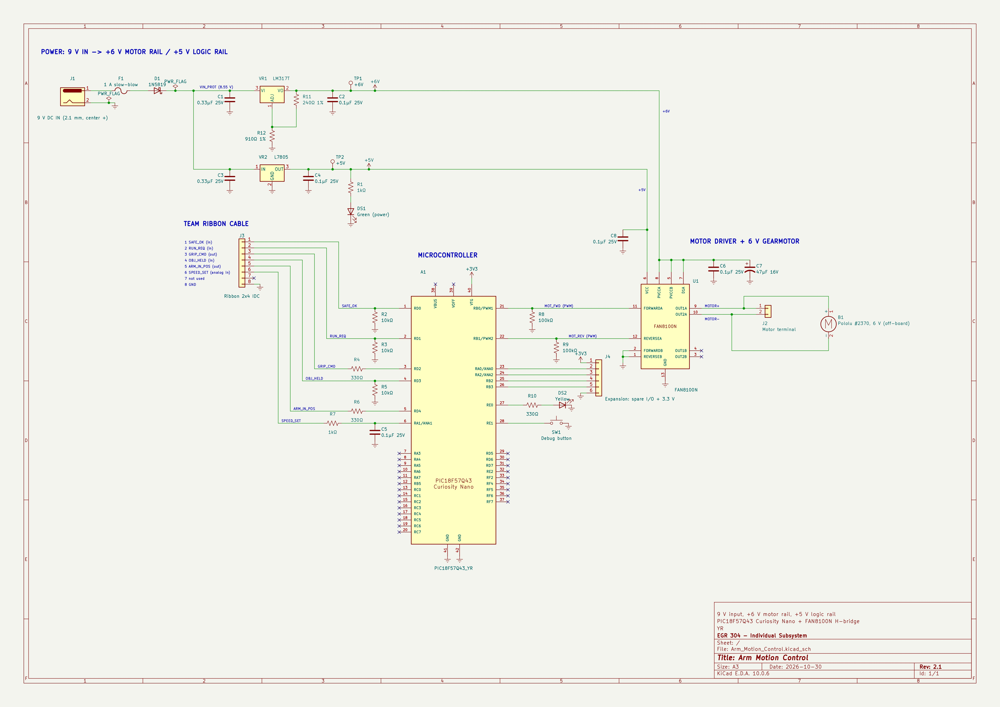

## Overview

This schematic is the Arm Motion Control subsystem of Team 107 (Simple Educational Robotic Arm). It is drawn in KiCad 9 with US/ANSI symbols, and parts are joined by wires rather than net labels wherever possible, so the signal path can be followed by eye. The sheet has five blocks:

* **Power:** a 9 V DC barrel jack (J1) feeds a 1 A slow-blow fuse (F1) and a 1N5819 reverse-polarity Schottky diode (D1), giving VIN_PROT of about 8.55 V. VR1 is an LM317T set to 6.0 V by R11 = 240 Ω and R12 = 910 Ω, using Vout = 1.25 V × (1 + 910 / 240) = 6.0 V. This 6 V rail is the motor rail. VR2 (L7805) makes the +5 V logic rail for the H-bridge VCC and the power LED DS1. Each regulator has 0.33 µF on its input and 0.1 µF on its output. Test points TP1 and TP2 are on the 6 V and 5 V rails.
* **Microcontroller:** a PIC18F57Q43 Curiosity Nano (A1), powered from its own USB port with 3.3 V logic.
* **Motor drive:** an onsemi FAN8100N H-bridge (U1, finned 12-DIPH package) drives the 6 V Pololu #2370 gearmotor through M+ and M−. The motor has only these two pins. RB0 and RB1 supply PWM through PPS. The motor supply has 47 µF and 0.1 µF bulk and decoupling capacitors.
* **Debug and expansion:**
    * A status LED on RE0.
    * A push button on RE1, using the weak pull-up.
    * J4, a 6-pin expansion header carrying 3.3 V, GND, RA0, RA2, RB2 and RB3.
* **Team ribbon (J3, 2×4 IDC):** pins 1 to 8 carry, in order:
    * SAFE_OK (in)
    * RUN_REQ (in)
    * GRIP_CMD (out)
    * OBJ_HELD (in)
    * ARM_IN_POS (out)
    * SPEED_SET (analog in)
    * pin 7, which is not used on this board
    * GND

  The three digital inputs have 10 kΩ pull-downs, so an unplugged cable reads 0, which means stop. The two outputs have 330 Ω series resistors. SPEED_SET has a 1 kΩ / 0.1 µF RC filter.

**Figure 1:** Arm Motion Control schematic.

## Resources

The schematic is available as a [*PDF download*](Arm_Motion_Control.pdf). The [*KiCad 9 project (Zip)*](Arm_Motion_Control.zip) 
