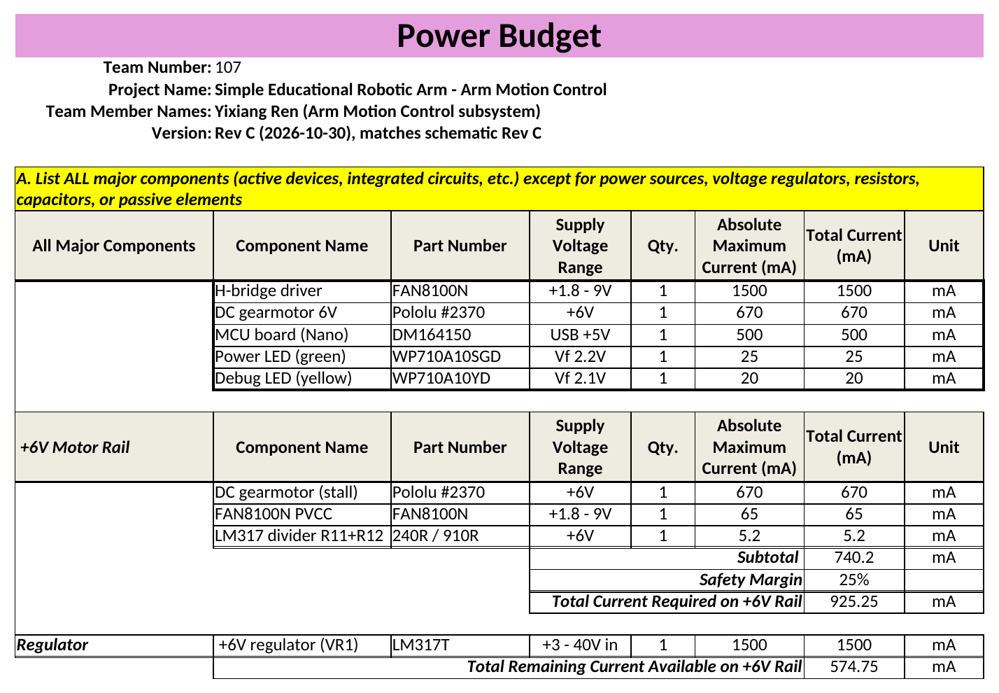
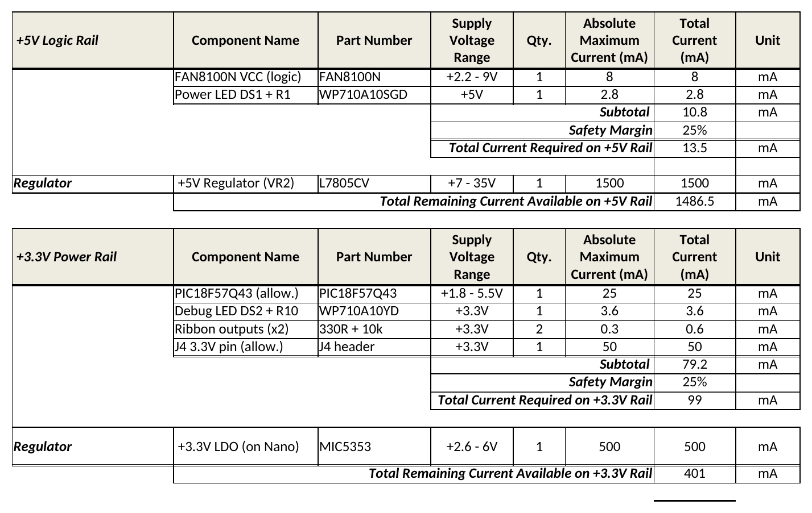
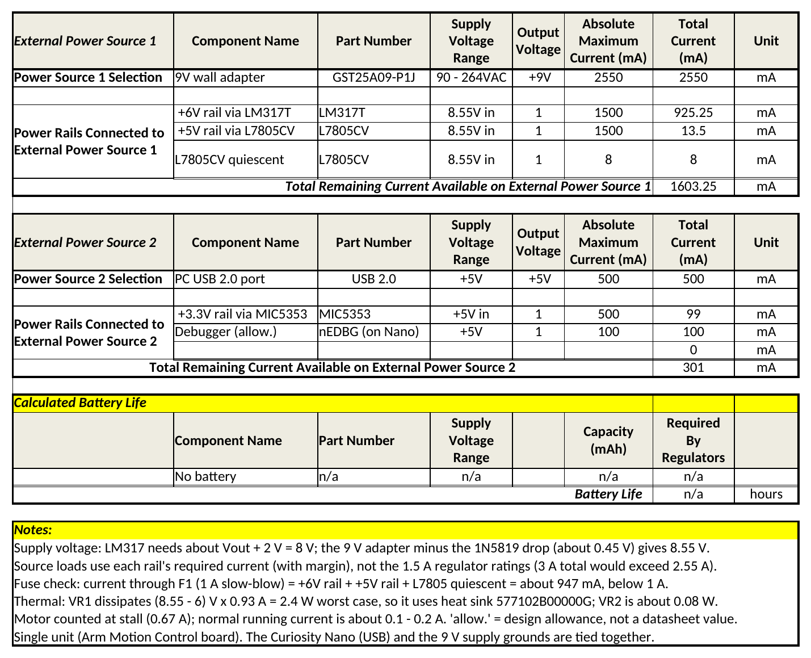

## Overview

This power budget checks that every supply and regulator on the Arm Motion Control board can deliver the worst-case current its loads can draw, with a 25 % safety margin. It is filled in on the **power budget template from the original assignment**. The board has two independent sources, and their grounds are tied together on the board:

* **9 V wall adapter** (MEAN WELL GST25A09-P1J, 2.55 A) → J1 → F1 (1 A slow-blow) → D1 (1N5819), giving about 8.55 V. This feeds two regulators:
    * **+6 V motor rail:** VR1, an LM317T set by R11 = 240 Ω and R12 = 910 Ω. It feeds the FAN8100N output stage and the Pololu #2370 6 V gearmotor.
    * **+5 V logic rail:** VR2, an L7805CV. It feeds the FAN8100N logic (VCC) and the power LED DS1.
* **USB port of the PC** (500 mA) → the Curiosity Nano's MIC5353 LDO → the **+3.3 V rail** for the PIC18F57Q43, the debug LED, the ribbon outputs and expansion header J4.

How the numbers were chosen:

* The major-component table lists each active part with its absolute maximum current from its datasheet: FAN8100N 1.5 A peak per channel, motor stall 0.67 A, Curiosity Nano regulator 500 mA, and LED forward-current ratings.
* The rail tables use the worst case each part can draw **in this circuit**. The motor is counted at its 0.67 A stall current. The FAN8100N is counted at its maximum supply current (65 mA PVCC, 8 mA VCC). The LEDs are counted at the current their resistors allow.
* Two values are design allowances rather than datasheet figures, and they are marked "allow." in the sheet: 25 mA for the MCU core and 50 mA reserved on the J4 3.3 V pin.
* On the external-source tables, the loads are each rail's required current (with margin), not the regulators' 1.5 A ratings. Adding the two ratings (3 A) would exceed the 2.55 A adapter even though the real demand is below 1 A.

**Figure 1:** Power budget, page 1. Major components and the +6 V motor rail.

**Figure 2:** Power budget, page 2. +5 V logic rail and +3.3 V rail.

**Figure 3:** Power budget, page 3. External power sources, battery life (not applicable) and notes.

## Summary

| Rail / source | Regulator or supply | Rating (mA) | Required with 25 % margin (mA) | Remaining (mA) |
|---|---|---:|---:|---:|
| +6 V motor rail | LM317T (VR1) | 1500 | 925.3 | 574.8 |
| +5 V logic rail | L7805CV (VR2) | 1500 | 13.5 | 1486.5 |
| +3.3 V rail | MIC5353 (Curiosity Nano) | 500 | 99.0 | 401.0 |
| 9 V source | MEAN WELL GST25A09-P1J | 2550 | 946.8 | 1603.3 |
| USB source | PC USB 2.0 port | 500 | 199.0 | 301.0 |

## Conclusions

The budget shows the following:

* **Every rail and source has headroom at worst case.** The tightest point is the +6 V rail, where motor stall plus margin uses about 62 % of the LM317T's 1.5 A rating.
* **The fuse is sized correctly.** Worst-case input current through F1 is about 947 mA, under the 1 A rating. F1 is slow-blow, so it rides through motor start-up and short stalls, but it still opens on a sustained fault. In normal running the motor draws about 0.1–0.2 A, far below this.
* **VR1 needs a heatsink.** At worst case it dissipates (8.55 − 6) V × 0.93 A ≈ 2.4 W, which is too much for a bare TO-220. The Aavid 577102B00000G heatsink is in the [BOM](../03-BOM/BOM.md). VR2 dissipates only about 0.08 W and needs none.
* **The FAN8100N stays well inside its limits.** Its 1.5 A per-channel output rating is more than twice the motor's stall current. Its estimated saturation loss at stall, about 0.6 W, is under the 2.0 W package rating.
* **The 9 V input gives the LM317T enough dropout margin.** After the reverse-polarity diode the input is 8.55 V, and the LM317T needs about 6 V + 2 V = 8 V.
* **One small risk is the LM317T minimum load.** The R11 / R12 divider draws 5.2 mA. That is above the typical 3.5 mA minimum load in the datasheet but below its 10 mA worst case. With the motor off, the 6 V rail could drift slightly high. If this shows up on the bench, a smaller divider (for example R11 = 120 Ω, R12 = 453 Ω) fixes it.

**How the budget shaped the design:** it is the reason the 6 V rail uses an LM317T with a heat sink and not a bare regulator, the reason the input supply is 9 V (high enough for the LM317T dropout, low enough to keep VR1 under about 2.4 W; a 12 V adapter would push VR1 to about 5 W), and the reason F1 is a 1 A slow-blow fuse. It also confirmed that the Curiosity Nano can stay on USB power, because the 3.3 V loads need only about 99 mA of its 500 mA regulator.

## Resources

The power budget is available as a [*PDF download*](Power_Budget_Arm_Motion_Control.pdf), as the [*Excel sheet*](Power_Budget_Arm_Motion_Control.xlsx), and as a [*Zip of both*](Power_Budget_Arm_Motion_Control.zip). The sheet's formulas recalculate if a value changes.
