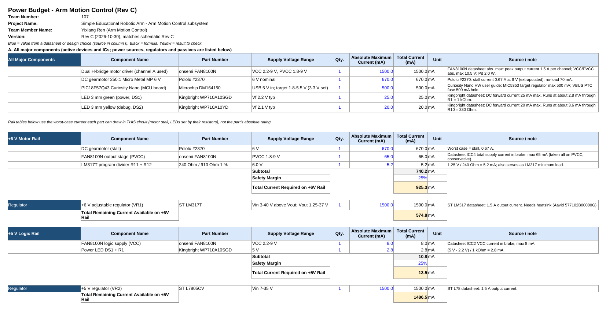
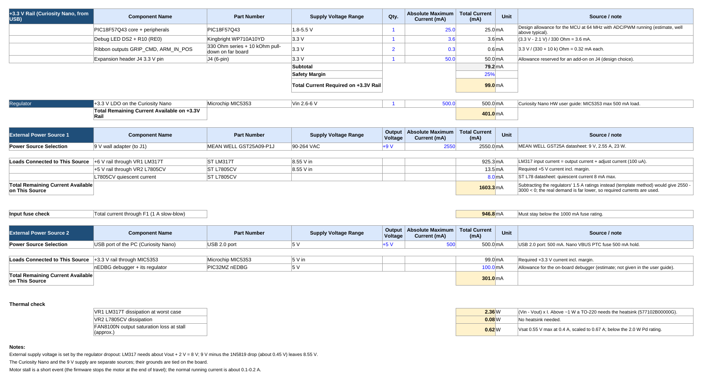

## Overview

This power budget checks that every supply and regulator on the Arm Motion Control board (schematic Rev C) can deliver the worst-case current its loads can draw, with a 25 % safety margin. The board has two independent sources, and their grounds are tied together on the board:

* **9 V wall adapter** (MEAN WELL GST25A09-P1J, 2.55 A) → J1 → F1 (1 A slow-blow) → D1 (1N5819), giving about 8.55 V. This feeds two regulators:
    * **+6 V motor rail:** VR1, an LM317T set by R11 = 240 Ω and R12 = 910 Ω. It feeds the FAN8100N output stage (PVCC) and the Pololu #2370 6 V gearmotor.
    * **+5 V logic rail:** VR2, an L7805CV. It feeds the FAN8100N logic (VCC) and the power LED DS1.
* **USB port of the PC** (500 mA) → the Curiosity Nano's MIC5353 LDO → the **+3.3 V rail** for the PIC18F57Q43, the debug LED, the ribbon outputs and expansion header J4.

All major parts are listed with their absolute maximum current ratings from the datasheets. Each rail table uses the worst case a part can draw in this circuit. For example, the motor is counted at its 0.67 A stall current, and the LEDs at the current set by their resistors. Every number has its source in the last column of the spreadsheet.

**Figure 1:** Power budget, page 1. Major components, +6 V rail and +5 V rail (click to enlarge).

**Figure 2:** Power budget, page 2. +3.3 V rail, external sources, fuse and thermal checks (click to enlarge).

## Summary

| Rail / source | Regulator or supply | Rating (mA) | Required with 25 % margin (mA) | Remaining (mA) |
|---|---|---:|---:|---:|
| +6 V motor rail | LM317T (VR1) | 1500 | 925.3 | 574.8 |
| +5 V logic rail | L7805CV (VR2) | 1500 | 13.5 | 1486.5 |
| +3.3 V rail | MIC5353 (Curiosity Nano) | 500 | 99.0 | 401.0 |
| 9 V source | MEAN WELL GST25A09-P1J | 2550 | 946.8 | 1603.3 |
| USB source | PC USB 2.0 port | 500 | 199.0 | 301.0 |

## Conclusions

The budget shows the following:

* **Every rail and source has headroom at worst case.** The tightest point is the +6 V rail, where motor stall plus margin uses about 62 % of the LM317T's 1.5 A rating.
* **The fuse is sized correctly.** Worst-case input current through F1 is about 947 mA, under the 1 A rating. F1 is slow-blow, so it rides through motor start-up and short stalls, but it still opens on a sustained fault. In normal running the motor draws about 0.1–0.2 A, far below this.
* **VR1 needs a heatsink.** At worst case it dissipates (8.55 − 6) V × 0.93 A ≈ 2.4 W, which is too much for a bare TO-220. The Aavid 577102B00000G heatsink is in the [BOM](../03-BOM/BOM.md). VR2 dissipates only about 0.08 W and needs none.
* **The FAN8100N stays well inside its limits.** Its 1.5 A per-channel output rating is more than twice the motor's stall current. Its estimated saturation loss at stall, about 0.6 W, is under the 2.0 W package rating.
* **The 9 V input gives the LM317T enough dropout margin.** After the reverse-polarity diode the input is 8.55 V, and the LM317T needs about 6 V + 2 V = 8 V.
* **One small risk is the LM317T minimum load.** The R11 / R12 divider draws 5.2 mA. That is above the typical 3.5 mA minimum load in the datasheet but below its 10 mA worst case. With the motor off, the 6 V rail could drift slightly high. If this shows up on the bench, a smaller divider (for example R11 = 120 Ω, R12 = 453 Ω) fixes it.

Two values are estimates rather than datasheet figures: the 25 mA allowance for the MCU core and the 100 mA allowance for the on-board debugger. Both are labeled as estimates in the spreadsheet.

## Resources

The power budget is available as a [*PDF download*](Power_Budget_Arm_Motion_Control.pdf) and as an [*Excel sheet*](Power_Budget_Arm_Motion_Control.xlsx). The sheet's formulas recalculate if a value changes.
