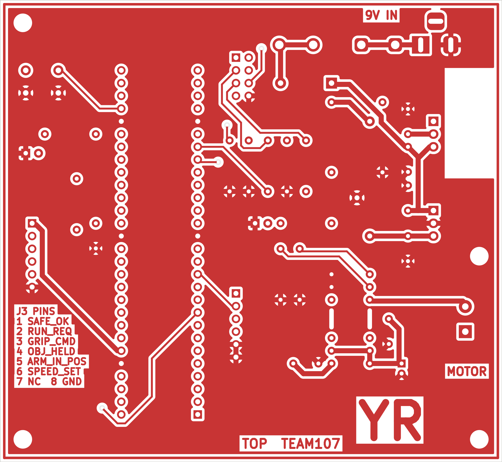
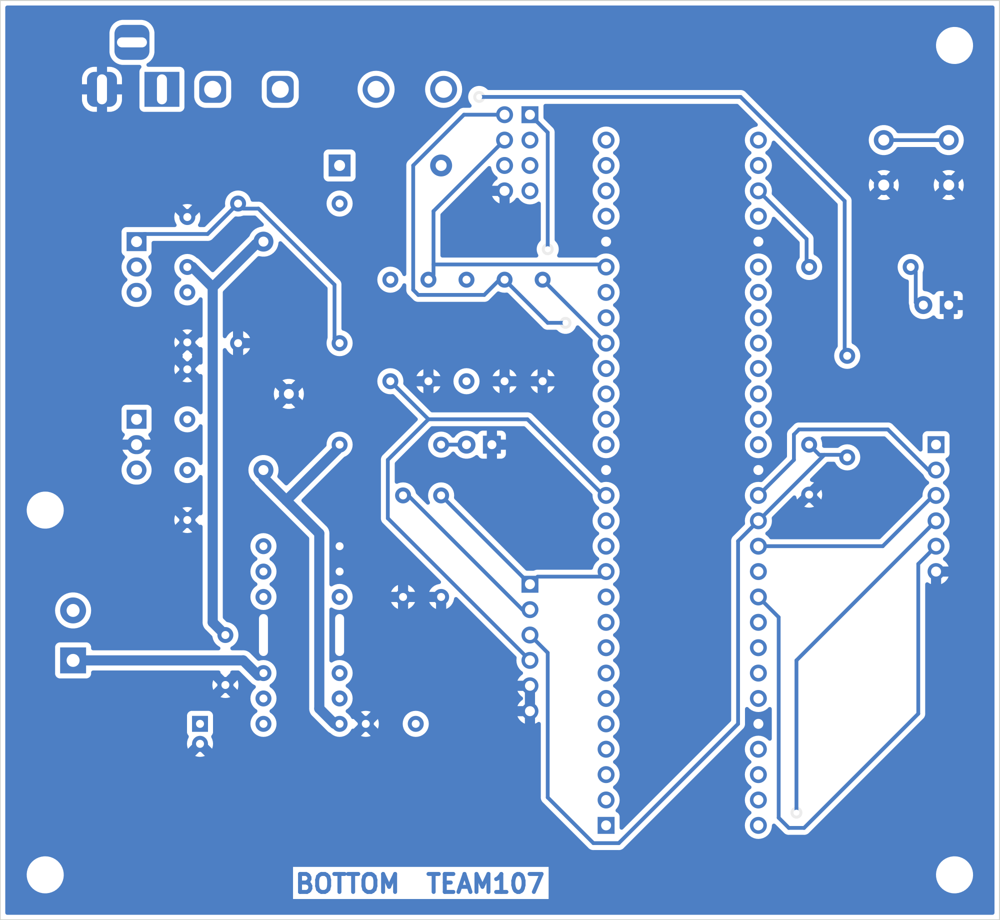

## Overview

This page shows the printed circuit board for the **Arm Motion Control** subsystem. The board is laid out in KiCad from the rev 2.5 [schematic](../04-Schematic/schematic.md). It is a two-layer through-hole board, made on the Peralta Labs LPKF ProtoMat S63 mill.

* **Size:** 100 mm × 92 mm, inside the 100 mm × 100 mm limit.
* **Layers:** top and bottom copper only. There is no solder mask or silkscreen on the milled board.
* **Copper:** 0.5 oz/ft². Both layers have a ground (GND) pour.
* **Initials:** "YR" in large bold text on the top copper. The copper layers are also labelled "TOP TEAM107" and "BOTTOM TEAM107".

## PCB Layout

**Figure 1:** Top copper layer (click to enlarge).

**Figure 2:** Bottom copper layer, mirrored as seen from the bottom of the board (click to enlarge).

## Layout

* **Microcontroller:** the PIC18F57Q43 Curiosity Nano (A1) sits in the left-centre of the board on two 1 × 28 female headers. Its USB connector faces the bottom edge. Only traces run under the Nano; no components or vias are placed there.
* **Power input:** this is the top-right corner. The 9 V jack J1 feeds fuse F1, then diode D1, then the regulators VR1 (LM317T, +6 V) and VR2 (L7805, +5 V).
    * Each regulator's input and output capacitors (C1–C4) sit next to its pins.
    * VR1's heat sink stands at the right edge. The top copper under it is removed, because the LM317T tab and the heat sink are at +6 V and the board has no solder mask.
* **Motor driver:** U1 (FAN8100N) is at the lower right.
    * C6, C7 and C8 decouple its supply pins.
    * The motor terminal J2 is on the right edge, so the motor leads leave the board directly.
    * The heat-sink fin leads of U1 connect solidly to the GND pour on both layers, so the pour helps cool the driver.
* **Team link:** the J3 2 × 4 header and its resistors R2–R6 are to the right of the Nano. The J3 pin-out is printed in copper at the lower left, because the board has no silkscreen.
* **Debug and test:**
    * Button SW1, debug LED DS2 and expansion header J4 are on the left.
    * Test points TP1 (+6 V), TP2 (+5 V) and TP3 (GND) are next to the regulators.
    * The 0.1 in test header J5 (PWM1, PWM2, SPEED_SET, ARM_IN_POS, GND) is beside the Nano.
* **Mechanical:** there are four M3 mounting holes. A copper outline runs around the board edge.

## Manufacturing Rules

| Rule | Requirement | This board |
|---|---|---|
| Board size | ≤ 100 × 100 mm | 100 × 92 mm |
| Layers | 2 copper, no solder mask or silkscreen | Top and bottom copper; mask and silkscreen files are included but not used |
| Copper | 0.5 oz/ft²; check traces above 500 mA with a trace width calculator | Worst case is 0.65 A, the 9 V input at motor stall. IPC-2221 (external layer, 10 °C rise, 0.5 oz) needs about 13 mil. |
| Power and ground traces | ≥ 40 mil wide, ≥ 6 mil spacing | All power, ground and motor traces are 40 mil (1.016 mm) |
| Signal traces | ≥ 15 mil width and spacing | 15 mil (0.381 mm) width, 15 mil clearance |
| Holes and vias | ≥ 0.5 mm, no blind or buried vias | Smallest hole 0.6 mm (vias, 23.6 mil); four through vias, none under a component |
| Ground plane | Pour on both sides | GND pour on top and bottom; thermal-relief spokes are 40 mil |
| Initials | Large bold text on top copper | "YR", 7 mm bold |
| Output files | Gerber RS-274X, Excellon drill in inches | See Downloads |

The power and ground rules are set as KiCad net classes: Default (15 mil track, 15 mil clearance) and Power (40 mil track). The custom rule file `Arm_Motion_Control.kicad_dru` gives the Nano GND pads and the FAN8100N fin a solid connection to the pour. The design rules check passes with **0 errors and 0 unconnected pads**.

The drill file uses 0.6, 0.8, 0.9, 1.0, 1.1, 1.3 and 1.7 mm holes plus the 3.2 mm mounting holes. The FAN8100N fin leads and the J1 power jack use slotted holes.

## Downloads

* PCB layout, top and bottom copper: [*PDF download*](Arm_Motion_Control_PCB.pdf). It is printed at 1:1 scale, so components can be checked against the printout before fabrication.
* KiCad project, including the schematic, the PCB, the YR_Custom symbol and footprint libraries and the design rules: [*Zip download*](Arm_Motion_Control_KiCad.zip).
* Gerber and drill files: [*Zip download*](YixiangRen107_Gerbers.zip). The zip contains Top.art, Bottom.art, Outline.art, SolderMaskTop.art, SolderMaskBottom.art, SilkscreenTop.art, SilkscreenBottom.art and Drill.drl.
