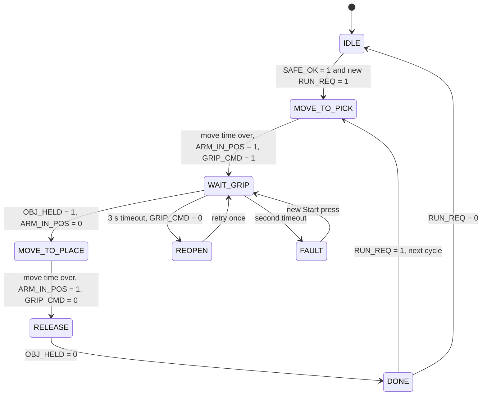

## Overview

This page holds the firmware used to verify the **Arm Motion Control** board's hardware. The board passed its Subsystem Hardware Verification check-off with this code.

* **Microcontroller:** PIC18F57Q43 Curiosity Nano, running at 64 MHz from HFINTOSC.
* **Tools:** MPLAB X IDE, the XC8 compiler and MCC Melody. MCC generates the clock, pin, ADCC (12-bit ADC) and PWM1_16BIT drivers.
* **Language:** C. One 1 ms main loop runs a small state machine.
* **Debug interface:** the on-board button SW1 (BTN_DBG, RE1) and LED DS2 (LED_DBG, RE0). The code does not use the UART.

**Download:** MPLAB X project, [*Zip download*](Arm_Control_MPLABX_Code.zip). Unzip it, then in MPLAB X choose **File → Open Project** and select the `Arm_Control.X` folder.

## Code Structure

| File | Purpose |
|---|---|
| `main.c` | Start-up, mode choice and the 1 ms main loop |
| `app/arm_config.h` | Every tunable number: start-up mode, PWM duty, move time, timeouts, debounce times |
| `app/arm_io.c/.h` | Board helpers: TMR0 1 ms time base, motor driver, team link inputs and outputs, SPEED_SET ADC, button debounce, LED patterns |
| `app/arm_test.c/.h` | TEST mode, used for hardware verification |
| `app/arm_app.c/.h` | APP mode, the team pick-and-place state machine |
| `mcc_generated_files/` | MCC Melody drivers (clock, pins, ADCC, PWM1_16BIT) |

Every millisecond the main loop does four things:

1. It debounces the team link inputs and the debug button.
2. It samples SPEED_SET with the ADC.
3. It runs the active mode, TEST or APP.
4. It updates the motor reversal gap and the LED.

TMR0 runs free in 16-bit mode at 250 kHz and is used as the time base, so no interrupt is needed.

## Pins Used

| Pin | Name | Direction | Use |
|---|---|---|---|
| RC4 | MOT_FWD | PWM out | PWM1 output 1 → FAN8100N FORWARDA (motor forward) |
| RC5 | MOT_REV | PWM out | PWM1 output 2 → FAN8100N REVERSEA (motor reverse) |
| RD0 | SAFE_OK | Digital in | Team link pin 1 |
| RD1 | RUN_REQ | Digital in | Team link pin 2 |
| RD2 | GRIP_CMD | Digital out | Team link pin 3 |
| RD3 | OBJ_HELD | Digital in | Team link pin 4 |
| RD4 | ARM_IN_POS | Digital out | Team link pin 5 |
| RA1 | SPEED_SET | Analog in (ANA1) | Team link pin 6, 0–3.3 V speed request |
| RE0 | LED_DBG | Digital out | Debug LED DS2 |
| RE1 | BTN_DBG | Digital in, weak pull-up | Debug button SW1 (active low) |

The motor PWM runs at 1 kHz (PR = 63 999). Only one of RC4 and RC5 is ever non-zero, which the FAN8100N needs. Before the direction changes, both outputs stay at 0 % for 250 ms so the motor can coast down.

## Hardware Verification (TEST mode)

TEST mode starts at power-up. It needs only the board, the 9 V supply, USB and a multimeter. Holding SW1 for 1.5 s stops the motor and switches between the two tests.

### Motor test

| Action | Result | DS2 |
|---|---|---|
| Power-up | Motor stopped, both PWM outputs 0 % | Slow blink (1 Hz) |
| Press SW1 | **Test 1:** the motor turns forward (PWM on RC4, RC5 = 0, 60 % duty) | On |
| Press SW1 again | **Test 2:** the motor turns in reverse (PWM on RC5, RC4 = 0) | 4 Hz blink |
| Keep pressing SW1 | **Test 3:** each change on the RE1 pin flips the direction | On / 4 Hz blink |
| Hold SW1 for 1.5 s | Motor stops; the board goes to the link test | — |

The PWM signals can be measured on test header J5 (pin 1 PWM1, pin 2 PWM2).

### Team link (ribbon) test

| Action | Result |
|---|---|
| Measure J3 pin 8 | Pin 8 is ground (continuity to TP3) |
| Press SW1 | **Write:** GRIP_CMD (pin 3) and ARM_IN_POS (pin 5) toggle together between 0 V and 3.3 V |
| Touch 3.3 V (J4 pin 1) to pin 1, 2, 4 or 6 | **Read:** DS2 turns on when SAFE_OK, RUN_REQ or OBJ_HELD reads 1, or when the ADC reads SPEED_SET above 1.65 V |
| Jumper pin 3 to pin 4 | **Read and write:** DS2 follows each button press |

When all inputs read 0, DS2 gives a short flash once a second.

## Team Operation (APP mode)

APP mode runs the pick-and-place cycle from the team [Software Proposal](https://egr304-2026-f-107.github.io/07-Software%20Proposal/). The board talks to the other two boards only through the 8-pin parallel team link. To start in APP mode, hold SW1 while the Nano powers up, or set `BOOT_MODE` to `MODE_APP` in `app/arm_config.h`.

**Figure 1:** APP mode state machine. SAFE_OK = 0 in any state sends the board to STOP (not drawn).

* **Safety first.** Every loop checks SAFE_OK before anything else. SAFE_OK = 0 sets both PWM outputs to 0 % within 1 ms. A restart needs SAFE_OK = 1 and a new Start press (RUN_REQ 0 → 1). An interrupted move then finishes the time it had left.
* **Speed.** SPEED_SET is averaged over 8 ADC samples and read at the start of each cycle. 0 V gives 35 % duty and 3.3 V gives 100 %. The move time is scaled by 60 % ÷ duty, so the arm turns about the same angle at any speed. The place move uses the same duty and time as the pick move, so the arm returns to its start position.
* **Pause.** If RUN_REQ goes to 0 during a move, the move finishes and the arm waits before the next one.
* **Debug LED DS2:**

    | State | DS2 |
    |---|---|
    | IDLE or PAUSED | Slow blink |
    | Moving | On |
    | Waiting for the gripper | 4 Hz blink |
    | STOP | Short flash once a second |
    | FAULT | 10 Hz blink |

## Download

* MPLAB X project for the Arm Motion Control board, including `README.md` with build and test steps: [*Zip download*](Arm_Control_MPLABX_Code.zip)
